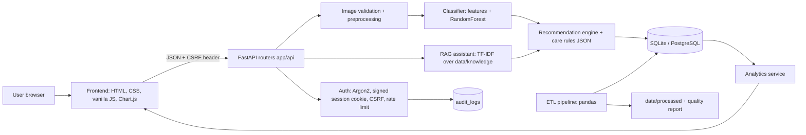

# Architecture

## Overview

The system is a single FastAPI application that serves both a JSON API and server-rendered HTML shells. The browser
(vanilla JavaScript + Chart.js, vendored locally) loads data from the API.

```
User -> Frontend (HTML/CSS/JS) -> FastAPI -> Authentication -> Data processing -> ML -> Recommendation -> Database -> Analytics
```



## Layers

| Layer | Location | Responsibility |
|---|---|---|
| Presentation | `app/templates`, `app/static` | 14 pages, one shared design system, no inline scripts (strict CSP) |
| API | `app/api/*.py` | Auth, fabric, recommendations, history, analytics, ETL, ML, assistant, security, settings |
| Core | `app/core` | Settings, DB engine, Argon2/session/Fernet helpers, CSRF, rate limiter, audit logger |
| Services | `app/services` | ETL, ML, RAG, recommendation, analytics, seed |
| Models | `app/models` | SQLAlchemy tables (see `ERD.md`) |
| ML scripts | `ml/` | `train.py`, `evaluate.py`, `predict.py` (thin CLIs over `app/services/ml`) |
| Data | `data/` | raw, processed, uploads, knowledge base, seed |

## Request path for an analysis

1. `POST /api/fabric/analyze` passes the CSRF check, the rate limiter and the session check.
2. `validate_image_bytes` checks size, extension, real image format, dimensions and decompression-bomb limits.
3. `preprocess_image` crops, resizes to 128x128 and scales to [0, 1].
4. `FabricClassifier.predict` extracts colour/texture features and returns class probabilities.
5. `recommend()` combines class, confidence, care rules and preferences. Low confidence adds a warning.
6. The image is re-encoded and stored under a random name in the user's folder; a `fabric_analyses` row is saved
   (note encrypted with Fernet) and audit events are written.

## Key design decisions

- **Rules in data, not in code or UI.** `data/knowledge/care_rules.json` drives recommendations, the assistant answers
  and the `fabric_knowledge` table (synced at start-up).
- **Local first.** Everything runs without the internet or AWS. The optional LLM only rephrases retrieved text.
- **Honest ML.** Metrics are produced by `ml/train.py` and read from `ml/artifacts/metrics.json`; the UI states the dataset source.
- **Single process.** The in-memory rate limiter and signed-cookie sessions suit one process; see `LIMITATIONS.md` and `CLOUD_ARCHITECTURE.md` for scaling.
