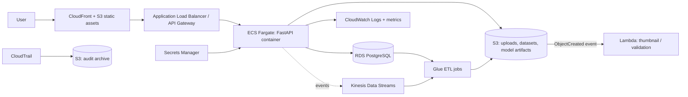

# Cloud architecture

> **Scope statement.** Everything in this project runs **locally** (SQLite + local folders + one Python process).
> **No AWS service is deployed or used by the code.** This document describes how the application *could* be deployed on AWS.

## 1. Implemented locally

```
User -> Web application (HTML/JS) -> FastAPI -> Authentication -> Image storage (data/uploads)
     -> ML processing (scikit-learn) -> Recommendation engine -> Database (SQLite) -> Analytics
```

## 2. Proposed AWS deployment (documentation only)

```
User -> CloudFront / web interface -> API Gateway or Application Load Balancer -> ECS (Fargate) / EC2 / Lambda
     -> S3 (images, datasets, artifacts) -> ML processing -> RDS PostgreSQL -> CloudWatch / CloudTrail
```



## 3. Service mapping

| Concern | Local implementation | AWS equivalent (proposed) | Status |
|---|---|---|---|
| Uploaded images | `data/uploads/<user_id>/<uuid>.jpg` | **Amazon S3** (private bucket, SSE-KMS, pre-signed URLs) | Documented only |
| Datasets / processed data / model artifacts | `data/raw`, `data/processed`, `ml/artifacts` | S3 prefixes `datasets/`, `processed/`, `models/` | Documented only |
| Image pre-processing trigger | In-request preprocessing | **AWS Lambda** on `s3:ObjectCreated` (thumbnails, validation, virus scan hook) | Documented only |
| Relational database | SQLite (dev) | **Amazon RDS for PostgreSQL** (Multi-AZ, automated backups) | `DATABASE_URL` already supports PostgreSQL (`requirements-postgres.txt`); not deployed |
| Backend hosting | `uvicorn` / Docker | **ECS Fargate** (container from `Dockerfile`) or EC2 behind an ALB | Dockerfile provided; not deployed |
| Logs and monitoring | stdout + `audit_logs` table | **CloudWatch** logs, metrics, alarms (5xx rate, latency, CPU) | Documented only |
| Security auditing | `audit_logs` table | **CloudTrail** for AWS API activity + application audit logs shipped to CloudWatch | Documented only |
| Large-scale ETL | pandas pipeline | **AWS Glue** (PySpark) jobs reading S3, writing Parquet; Glue Data Catalog | Documented only |
| Real-time events | none | **Kinesis Data Streams** for analysis events -> Glue/Athena analytics | Documented only |
| Secrets | `.env` | **Secrets Manager / SSM Parameter Store** for `SECRET_KEY`, `FERNET_KEY`, DB password | Documented only |
| Rate limiting | in-memory limiter | API Gateway usage plans / AWS WAF rate rules (in-memory limiter is per-process) | Documented only |
| TLS / headers | `COOKIE_SECURE`, HSTS flag | ACM certificate on ALB/CloudFront, WAF managed rules | Documented only |

## 4. Changes needed before a real AWS deployment

1. Store uploads in S3 (replace the filesystem calls in `app/api/fabric.py` with an `ImageStore` interface: local and S3 implementations).
2. Use PostgreSQL (`DATABASE_URL=postgresql+psycopg2://...`) and add Alembic migrations instead of `create_all`.
3. Move sessions/rate limits to a shared store (Redis/ElastiCache) or rely on API Gateway/WAF, because the in-memory limiter does not work across several containers.
4. Run the model from an S3 artifact (download at start-up) and consider a managed endpoint (SageMaker) if load grows.
5. Inject secrets from Secrets Manager; set `ENVIRONMENT=production` and `COOKIE_SECURE=true`.
6. Add CloudWatch alarms, a WAF, and automated backups with a tested restore.

See `DEPLOYMENT.md` for the container steps that are possible today.
