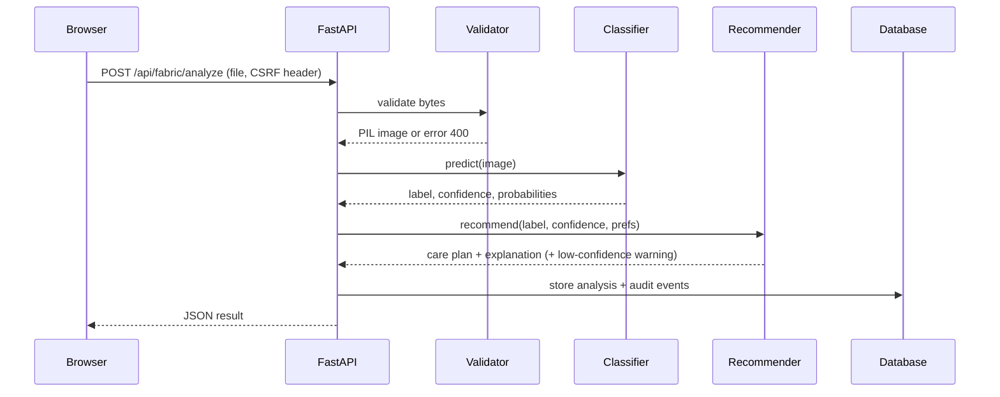
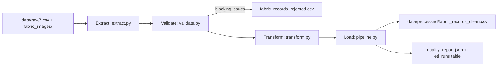

# Data flow

## Fabric analysis

```
Fabric image
   |  validation (type, size, real format, dimensions)
   v
Preprocessing (EXIF fix, centre crop, resize 128x128, normalise 0..1)
   v
Feature extraction (HSV stats + histograms, gradients, FFT bands, block variance, LBP)
   v
ML model (StandardScaler + RandomForest) -> class probabilities
   v
Fabric classification (top class + confidence)
   v
Recommendation engine (care rules + confidence + preferences)
   v
Database (fabric_analyses, audit_logs; encrypted note)
   v
Dashboard / History / Analytics (queries scoped to the signed-in user)
```



## ETL pipeline (`app/services/etl/`)



| Stage | What happens |
|---|---|
| Extract | CSV read as text (so validation sees raw values); image folder scanned and every image opened |
| Validate | Required columns (schema); missing label, unknown fabric, malformed filename, bad temperature (0-95 C), bad ironing level, bad date, duplicate record id, missing values |
| Transform | Normalise names/aliases (e.g. "Jeans" -> denim), parse "40 C", drop duplicates (same fabric + filename), impute missing optional values from the knowledge base (counted), label-encode fabric, min-max normalise temperature |
| Load | Clean CSV, rejected CSV with reasons, JSON quality report, `etl_runs` row |

The quality report lists total / valid / invalid / duplicate records, missing values, supported categories, image dimensions,
class distribution, and preprocessing results (target size, channel mean/std, 70/15/15 split sizes).

## Assistant (RAG)

```
Question -> injection filter -> fabric + intent detection -> care rules (deterministic)
                             -> TF-IDF cosine retrieval over data/knowledge/*.md
                             -> concise answer + source list -> (optional LLM rephrase of retrieved text only)
```
