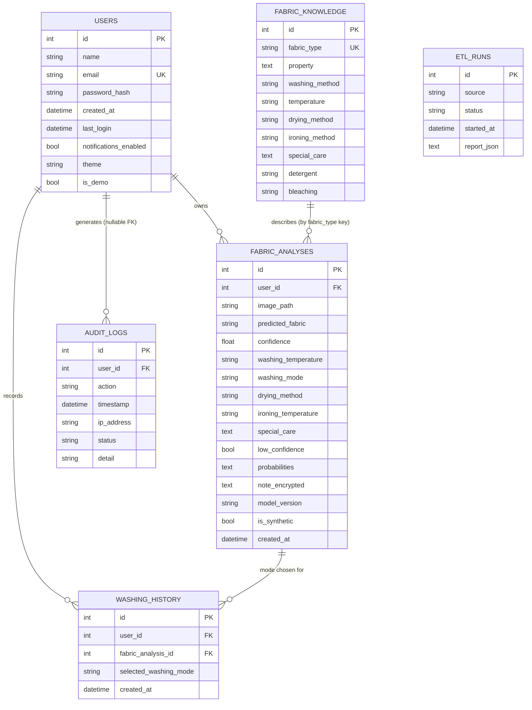

# Entity-relationship diagram

Notes:

- `fabric_analyses.user_id` and `washing_history.*` use `ON DELETE CASCADE`; `audit_logs.user_id` uses `ON DELETE SET NULL`, so the audit trail survives user deletion.
- `fabric_knowledge` is linked to analyses by the shared `fabric_type` key (not a hard foreign key, so rules can evolve without breaking history).
- `etl_runs` stores one JSON quality report per pipeline run.
- `note_encrypted` holds Fernet ciphertext. `is_synthetic` marks Synthetic Demo Data.
